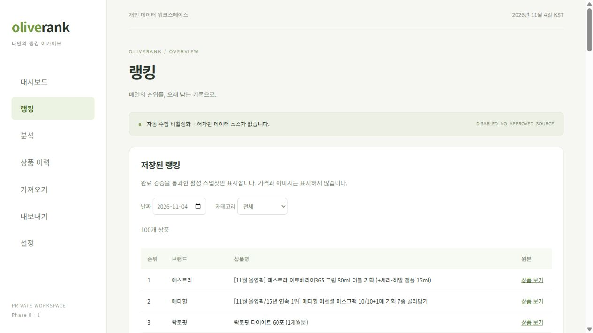

# 실제 올리브영 전체 랭킹 가져오기

## 이번에 완료한 작업

2026-11-04 **13:47:21 KST** (`2026-11-04T04:47:21.447Z`)에 정상 표시된 [올리브영 전체 랭킹](https://www.oliveyoung.co.kr/store/main/getBestList.do)에서 실제 1~100위를 브라우저로 읽었습니다. 첫 접속에는 접속 확인 화면이 표시됐지만 별도 조작 없이 정상 페이지로 전환됐습니다. CAPTCHA 해결, 봇 위장, 프록시, 비공개 API, 차단 우회는 사용하지 않았습니다.

- 1위: 에스트라 — 아토베리어365 크림 80ml 더블 기획, 상품 ID `A000001002386`
- 2위: 메디힐 — 에센셜 마스크팩 10/10+1매 기획, 상품 ID `A000000223414`
- 3위: 락토핏 — 다이어트 60포, 상품 ID `A000000225666`
- 100위: 메디큐브 — 패드 3종 1+1 140매 리필 기획, 상품 ID `A000000255682`

이는 읽은 시점의 순위이며 페이지 내용은 이후 달라질 수 있습니다. 과거 날짜 랭킹을 복원했다고 주장하지 않습니다.

결과 파일은 작업 폴더의 `data/oliveyoung-overall-2026-11-04.json`에 저장했습니다. 가격·이미지 필드는 없습니다. `data/`는 Git에서 제외합니다. 전체 100행을 앱에서 선택하고 20행 청크 API로 **로컬 D1의 overall/2026-11-04 COMPLETE·활성 스냅샷**에 저장했습니다. 같은 파일을 다시 가져온 후에도 새 중복 스냅샷 없이 완료를 확인했습니다. 가상 스킨케어 샘플과 카테고리가 달라 별개로 보존됩니다.

## 다음에 직접 가져오는 방법

1. Git Bash에서 프로젝트 폴더로 이동하고 `bash ./start-local.sh`로 앱을 실행합니다.
2. 로컬 로그인 후 **가져오기 → 실제 올리브영 전체 랭킹 가져오기**를 엽니다. 주소는 로컬 `/capture.html`입니다.
3. 안내 페이지의 **OliveRank 전체 랭킹 저장** 버튼을 평소 사용하는 브라우저의 북마크바에 끌어 놓습니다. 브라우저별 북마크 기능을 사용하며 확장 프로그램은 설치하지 않습니다.
4. 올리브영 랭킹 페이지를 직접 열고 **전체**를 선택합니다. 상품 100개가 정상 표시된 뒤 북마크를 누르면 JSON 파일이 다운로드됩니다.
5. OliveRank 가져오기 화면에서 그 JSON을 선택하고 미리보기를 확인한 뒤 저장합니다. 같은 날짜의 다른 기록을 교체할 때는 명시적으로 교체 확인을 선택해야 합니다. 이전 버전은 남습니다.
6. **랭킹** 메뉴에서 날짜·카테고리를 골라 100개를 확인합니다. 검색·등락·차트는 후속 범위입니다.

북마크 도구는 현재 DOM만 읽습니다. 페이지 추가 요청·상품 상세 페이지 순회·스크롤 자동화·예약 실행이 없으며 가격·이미지·추적 파라미터를 추출하지 않습니다. 화면 100개가 없거나 다른 카테고리/접속 확인 화면이면 실패합니다. 사이트 구조가 바뀌면 파서 검토가 필요합니다. 브라우저나 사이트 CSP가 북마크 실행을 막는 환경은 미검증이며 그 경우 실행 차단을 우회하지 않습니다.

## 변경한 파일

| 파일                                                        | 역할                                                               |
| ----------------------------------------------------------- | ------------------------------------------------------------------ |
| `src/client/capture.ts`                                     | 실제 확인한 DOM 선택자로 전체 100개 필드 추출, 현재 화면만 읽음    |
| `scripts/build-capture.mjs`, `public/capture.html`          | 추출 함수를 포함하는 자체 완결 북마크 도구·사용 안내 생성          |
| `src/shared/browserCapture.ts`                              | JSON 형식·상품 ID/URL 일치·100행·UTC/KST 일치 검증                 |
| `src/client/main.tsx`                                       | 실제 JSON 가져오기·원래 수집 시각 보존·출처 표시·가격 UI 제거      |
| `src/client/ImportedRankings.tsx`, `style.css`              | 저장된 전체 순위 조회, 날짜·카테고리 선택, 원본 링크               |
| `src/client/importer.ts`, `src/worker/index.ts`             | 기존 CSV/XLSX 가격/이미지 열 무시, 새 DB 가격 NULL 저장            |
| `tests/capture.test.ts`, `tests/import.test.ts`             | DOM·JSON·북마크 다운로드 검증, 기존 테스트를 가격 제외 요구에 맞춤 |
| `scripts/verify-capture.mjs`                                | 실제 캡처와 로컬 API의 100행 필드 일치·가격 미저장 확인            |
| `package.json`, `pnpm-lock.yaml`, `.gitignore`, `README.md` | 빌드·테스트 의존성 및 가이드·실데이터 파일 제외                    |

DB migration은 추가하지 않았습니다. 기존 가격/이미지 컬럼은 스키마 호환을 위해 그대로 두며 새 입력에 값은 저장하지 않습니다. 기존 저장 데이터는 삭제하거나 덮어쓰지 않았습니다.

## 검증

`bash ./pnpmw build`, `bash ./pnpmw lint`, `bash ./pnpmw test`로 검증했습니다. 기존 D1 테스트 27개와 캡처 테스트 10개가 통과했습니다. 전체 테스트 실행 후 추가한 북마크 생성물 테스트는 캡처 테스트 파일을 다시 실행해 확인했습니다. ExcelJS 청크 크기에 대한 기존 Vite 경고는 남아 있습니다.

앱 화면에서 실제 JSON 선택 → 100행 검증 → 업로드 → COMPLETE 표시 → 재업로드를 확인했습니다. 조회 화면 DOM의 상품 행은 100개입니다. 실제 파일/API 대조는 서버 실행 중 다음 명령으로 재현합니다.

```bash
bash ./pnpmw verify:capture data/oliveyoung-overall-2026-11-04.json
```

이 검증은 올리브영에 요청하지 않고 로컬 Worker에서만 읽습니다. JSON의 100개 상품과 저장된 모든 순위/ID/브랜드/상품명/링크가 일치하며 가격은 모두 NULL인지 확인합니다.



## 운영 범위

현재 구현은 **사용자 주도 브라우저 가져오기**입니다. Cloudflare 서버 직접 크롤링과 Cron은 구현·활성화하지 않았습니다. [robots.txt](https://www.oliveyoung.co.kr/robots.txt)의 일반 크롤러 제한과 기존 요구사항을 유지합니다. 브라우저로 읽은 사실은 정기 자동 수집 허가가 확인됐다는 의미가 아닙니다. 유료 서비스·원격 배포는 사용하지 않았으며 데이터는 이 PC 로컬 D1에 저장했습니다.
