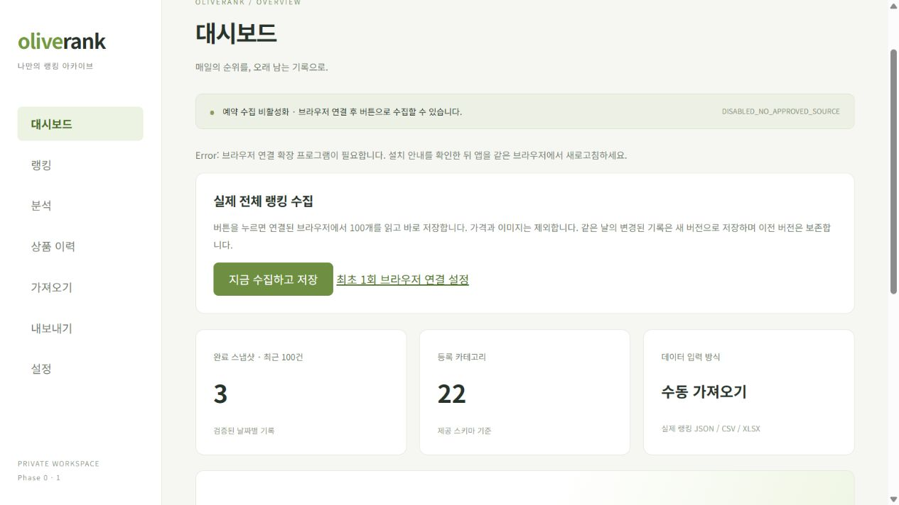

# 버튼 한 번으로 수집·저장

## 사용법

1. Git Bash에서 프로젝트 폴더로 이동한 뒤 `bash ./start-local.sh`로 실행합니다.
2. 평소 사용하는 웨일·Chrome·Edge에서 확장 프로그램 관리 → 개발자 모드 → 압축해제된 확장 프로그램 로드를 선택합니다.
3. 현재 프로젝트의 `extension` 폴더를 선택합니다.
4. **같은 브라우저**에서 `http://127.0.0.1:8787`에 접속해 로그인하고 페이지를 새로고침합니다.
5. 대시보드 또는 가져오기 화면의 **지금 수집하고 저장**을 누릅니다.

최초 확장 프로그램 설치 후에는 북마크 실행, JSON 다운로드·선택·업로드가 필요 없습니다. 앱에도 `/extension-setup.html`에 같은 설치 안내가 있습니다. Codex 내장 브라우저와 모바일은 지원하지 않습니다. 향후 workers.dev 배포 주소는 현재 확장 프로그램의 허용 주소에 포함되지 않습니다.

## 동작

실제 사용자 버튼 클릭 → 로컬 content script → extension service worker → 올리브영 전체 랭킹 새 탭 → 정상 DOM 100행 읽기 → 앱에서 JSON 검증 → 기존 20행 청크 API → COMPLETE 검증 및 저장입니다. 자동으로 연 자체 탭은 성공하면 닫고, 실패하면 표시합니다. 사용자가 이미 열어둔 탭은 수정하거나 닫지 않습니다.

순위·상품 ID·브랜드·상품명·상품 링크·UTC 수집 시각/KST 날짜만 읽습니다. 가격·이미지·쿠키·비밀번호·방문 기록을 읽거나 저장하는 API는 없습니다. 수집 결과는 해당 로컬 앱으로만 전달하며 기존 인증/Origin 검증을 거쳐 저장합니다. Worker가 올리브영에 요청하거나 브라우저를 실행하지 않아 무료 Worker CPU에 HTML 파싱 부담을 추가하지 않습니다.

같은 날짜에 내용이 바뀌면 버튼 실행 시 새 버전을 만들고 이전 COMPLETE 버전은 보존합니다. 버튼 위에 이 동작을 안내했습니다. 내용이 같은 경우 교체 옵션과 관계없이 기존 완료 스냅샷을 반환합니다. 이로써 버튼 재클릭도 멱등 처리합니다. 순위가 불완전하거나 수집에 실패하면 기존 활성 기록은 유지됩니다.

## 연결 및 실패 처리

- 페이지 로딩 최대 20초, DOM 대기 최대 15초. 앱 연결 응답 제한은 40초입니다.
- 확장 미설치/다른 브라우저에서는 1초 후 설치 안내를 표시합니다.
- 확장 content script는 로컬 8787 포트의 최상위 창에서 실제 버튼 클릭 직후의 요청만 받습니다.
- 창·Origin·메시지 채널·요청 ID·응답 종류를 확인합니다. background에서도 확장 ID·sender URL·최상위 프레임을 검사합니다.
- 전체 탭 읽기 권한인 `tabs`나 `history`, `cookies`, `alarms`는 요청하지 않습니다. `scripting`과 올리브영 호스트 권한 및 로컬 앱 content script만 사용합니다. Chrome 호스트 권한은 도메인 범위이므로 실행 코드에서 랭킹 URL도 다시 확인합니다.
- 접속 확인 화면이 자연스럽게 완료되기를 기다리며 CAPTCHA 클릭·위장·프록시·재요청 루프·내부 API 호출은 없습니다. 페이지가 정상화되지 않으면 탭을 표시하고 실패를 반환합니다.
- 예약 실행이나 백그라운드 주기 수집은 없습니다. 사용자 클릭으로만 실행합니다.

## 구현 파일

`extension/manifest.json`, `background.js`, `bridge.js`, `capture-function.js`가 브라우저 연결을 담당합니다. `capture-function.js`는 `src/client/capture.ts`에서 `scripts/build-capture.mjs`로 생성합니다. 앱은 `src/client/browserBridge.ts`로 연결하고 `main.tsx`의 기존 업로드 흐름을 재사용합니다. `src/worker/index.ts`는 명시적 버전 교체에서도 동일 source_ref를 멱등 처리하도록 보완했습니다.

확장 프로그램 또는 capture 함수 코드를 변경하면 앱 빌드 후 브라우저 확장 관리 화면에서 확장을 다시 로드하고 앱도 새로고침하세요. 런타임에 외부 코드를 다운로드하지 않습니다.

## 검증과 한계

기존 D1/CSV/XLSX/캡처 테스트 외에 확장 수집 제어·허용 Origin/프레임/확장 ID·중복 실행·불완전 결과·메시지 검증·미설치·실제 클릭 필요 조건을 API 모의 환경에서 테스트했습니다. 생성된 북마크 캡처 함수는 DOM 재현 테스트를 공유합니다.

**실제 웨일·Chrome·Edge에 설치한 뒤 사이트부터 DB까지 버튼 한 번으로 완료하는 검증은 아직 하지 않았습니다.** 확장 설치는 사용자 브라우저에서 한 번 필요합니다. 모의 API 테스트 통과를 실제 확장 설치·실행 성공으로 간주하지 않습니다. 이전 작업에서 정상 브라우저 DOM의 실제 전체 100개를 읽어 로컬 D1에 저장한 검증은 별도로 완료되어 있습니다.

설계 참고: [Chrome scripting](https://developer.chrome.com/docs/extensions/reference/api/scripting), [content scripts](https://developer.chrome.com/docs/extensions/develop/concepts/content-scripts), [tabs host permissions](https://developer.chrome.com/docs/extensions/reference/api/tabs).

### 이번 실행 결과

타입 검사·ESLint·Vite 빌드 통과. 전체 테스트 48개 통과 후, 추가한 함수 직렬화/접속 확인 화면 대기 종료 테스트를 포함해 확장 테스트 13개를 별도 실행해 통과했습니다(검증한 고유 테스트 총 50개). 내장 브라우저에서는 확장 미설치 시 1초 후 설치 안내가 표시되고 저장이 시작되지 않는 것을 확인했습니다. 실제 브라우저 확장 설치 후의 전체 수집은 아직 미검증입니다.

