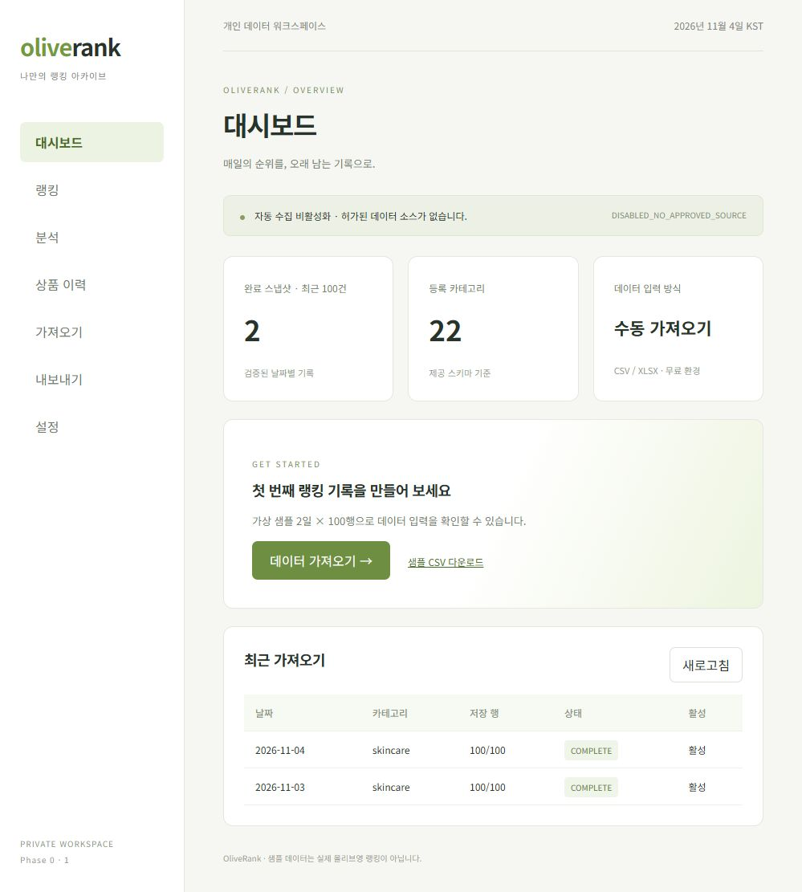
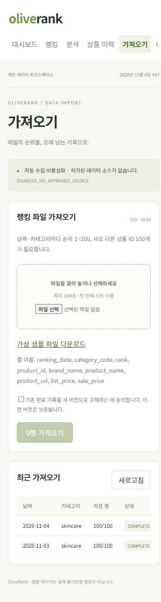

# Phase 0·1 결과 보고

기준: 2026-11-04 Asia/Seoul. 원격 배포 없이 로컬 샘플 검증. 제공 PRD/구현 프롬프트를 읽고 이번 요청에 따라 Phase 0·1만 구현했습니다.

## Phase 0

구현 파일: `package.json`, `pnpm-lock.yaml`, `pnpm-workspace.yaml`, `tsconfig.json`, `vite.config.ts`, `vitest.config.ts`, `eslint.config.js`, `wrangler.jsonc`, `index.html`, `.gitignore`, `.dev.vars.example`, `scripts/local-setup.mjs`, `src/client/main.tsx`, `src/client/style.css`, `src/worker/index.ts`, `README.md`.

React/Vite SPA, 한국어 반응형 화면, Hono Worker, 단일 Wrangler Static Assets/API, 타입/린트/Vitest 구성, 기본 인증 거부, 로컬 인증과 실행 가이드를 만들었습니다. 대시보드에는 실제 로컬 샘플 입력 상태와 빈 상태 안내가 표시됩니다. 후속 메뉴는 미구현 단계로 명시합니다.

검증 명령: `pnpm typecheck`, `pnpm lint`, `pnpm build`, `pnpm dev:worker`. TypeScript/ESLint/프로덕션 빌드 통과, Wrangler `Ready on http://127.0.0.1:8787` 및 인증 후 SPA HTTP 200 확인. API/UI 익명 요청 HTTP 401, 다른 Origin POST HTTP 403을 확인했습니다.

실행: `pnpm install --frozen-lockfile` → `pnpm setup:local` → `pnpm db:migrate` → `pnpm dev`. Node가 PATH에 없는 이 PC의 번들 경로 설정은 README에 있습니다.

## Phase 1

구현 파일: `migrations/0001_initial.sql`, `migrations/0002_import_guards.sql`, `fixtures/sample_rankings_2days.csv`, `public/sample_rankings_2days.csv`, `src/shared/schemas.ts`, `src/client/importer.ts`, `src/worker/providers/RankingSource.ts`, `ManualImportProvider.ts`, `FixtureProvider.ts`, `tests/import.test.ts`, `scripts/smoke.mjs`. Phase 0의 UI/API에 가져오기 흐름도 추가했습니다.

제공 스키마 원본 적용, 22개 카테고리 seed, 제공된 2일×100행 CSV 보존, CSV/XLSX 브라우저 파싱과 미리보기, 날짜·순위·상품·URL·가격 검증, 20행 청크 업로드, 실행 취소/실패 기록, 완료 검증, 명시적 새 버전 교체, 이전 버전 보존, 동일 재업로드 및 청크 재전송 멱등성을 구현했습니다. 미완성 스냅샷은 검증용 랭킹 조회에서 제외합니다.

마이그레이션 명령: `pnpm exec wrangler d1 migrations apply olive-rank --local`. 실제 Wrangler에서 두 파일 모두 적용 성공을 확인했습니다. 원본 스키마는 수정하지 않았습니다.

테스트: `pnpm test`의 27개 테스트 통과. CSV/XLSX 한글·가격·URL·열 매핑, null/0, 잘못된 날짜/ID/URL/범위, 중복/누락 순위와 상품 ID, 수식 셀 거부/중화 헬퍼, 인증 차단, Origin 검증, 부분 저장 비공개, 청크 재전송, 충돌 롤백, 2일 전체 저장, 중복 업로드, 교체 확인, 취소, 이전 버전 보존을 검증했습니다. 초기 테스트는 SQL 테스트 로더가 트리거를 잘못 분리해 실패했고 수정했습니다. 이후 Windows Miniflare RPC 지연으로 기본 5초 제한을 초과해 30초로 조정했으며 재실행은 통과했습니다.

Wrangler HTTP 검증: 서버 실행 상태에서 `pnpm test:smoke` 성공. API auth PASS, SPA PASS, categories=22, 2026-11-03=100행, 2026-11-04=100행. smoke가 로컬 DB에 샘플을 저장하므로 앱을 실행하면 바로 확인할 수 있습니다.

브라우저 검증: 로컬 로그인 → 가져오기 → 실제 샘플 CSV 파일 선택 → 200행 미리보기 → 가져오기 실행 → `200행 처리 완료 · 동일 파일은 중복 저장하지 않습니다` 표시 확인. 완료 스냅샷 두 개 유지. XLSX 파일 경로는 자동 테스트에서 실제 ExcelJS 워크북 생성/파싱으로 검증했습니다.

## 제한과 후속 작업

- 완료/취소 요청의 동시 처리 시 실제 DB 최종 상태에 맞는 응답을 반환하도록 보완하고 통합 테스트로 확인했습니다. 64KiB 본문 제한과 직접 DB 완료 차단 테스트도 통과했습니다.
- 파일별 원자성이 아닌 날짜·카테고리별 원자성입니다. 일부 그룹 성공 후 다른 그룹이 실패하면 성공분은 남습니다.
- 이력은 100건/페이지 API이며 현재 UI는 최근 100건을 표시합니다. 대시보드 완료 수 역시 최근 100건 기준입니다.
- ExcelJS 지연 청크 약 940kB(minified)로 Vite 크기 경고가 있습니다. 최초 화면 청크와 분리되며 Worker에서 ExcelJS를 실행하지 않습니다.
- 원격 Worker CPU 10ms 및 실제 비용/Access 정책은 미검증입니다. 로컬 응답시간을 원격 CPU로 보고하지 않습니다.
- Phase 2 조회/검색/등락/차트, Phase 3 내보내기, Phase 4 배포·운영·모니터링, Phase 5 허가된 공급자는 미구현입니다.
- 실데이터 접근 허가는 미확인입니다. 외부 올리브영 요청을 구현하거나 실행하지 않았고, Cron은 없으며 자동 수집은 `DISABLED_NO_APPROVED_SOURCE`입니다.

무료 한도/배포 설정/백업 순서는 `operations.md`, 트랜잭션·인증 구조는 `architecture.md`에 기록했습니다. 의존성·설계 확인에 사용한 공식 문서: [Cloudflare D1](https://developers.cloudflare.com/d1/platform/limits/), [Static Assets](https://developers.cloudflare.com/workers/static-assets/routing/worker-script/), [Access](https://developers.cloudflare.com/workers/configuration/cloudflare-access/), [pnpm settings](https://pnpm.io/settings).

## 화면 기록

최종 27개 테스트 통과(총 실행 34.50초), 타입/린트/빌드 통과, Wrangler smoke 재실행 통과. 제공 SQL 및 CSV와 프로젝트 사본의 SHA-256 일치를 확인했습니다.

데스크톱 대시보드와 390px 모바일 가져오기 화면을 확인했습니다. 모바일 메뉴와 표는 가로 스크롤하며 입력 카드와 안내는 화면 폭에 맞게 배치됩니다.

