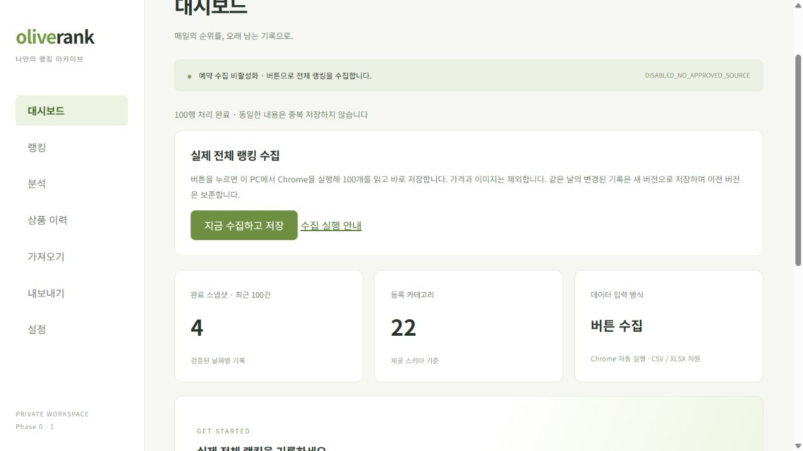

# Selenium 버튼 수집 — 구현 및 검증

## 실행 방법

기존 서버가 실행 중이면 해당 터미널에서 Ctrl+C로 종료하고, Git Bash에서 다음을 실행합니다.

```bash
cd /c/Users/user/Documents/Codex/2026-11-04/https-github-com-hansg0325-cosmetics-rank/work/Cosmetics-Rank
bash ./start-local.sh
```

`http://127.0.0.1:8787`에 로그인한 뒤 **지금 수집하고 저장**을 누릅니다. Chrome이 화면 없이 실행되고 전체 100개를 검증한 후 기존 D1 업로드 API로 저장합니다. 확장 프로그램 설치, 북마크 실행, 파일 다운로드·업로드는 필요하지 않습니다. 이전 확장 프로그램을 설치했더라도 현재 버튼에는 연결하지 않으므로 중복 수집하지 않습니다.

Node.js/pnpm은 기존 `pnpmw`가, Python은 `scripts/dev.mjs`가 이 PC의 번들 런타임 또는 시스템 설치 경로에서 찾습니다. Selenium 4.52.0은 최초 실행 시 `.local-browser/python-deps`에 설치하며 전역 Python 환경은 변경하지 않습니다. ChromeDriver는 Selenium Manager가 준비합니다. 인터넷 연결과 Chrome 설치가 필요합니다.

다른 PC에서는 `COSMETICS_RANK_PYTHON`, `COSMETICS_RANK_CHROME_BINARY` 환경변수로 실행 파일 경로를 지정할 수 있습니다. 기본 앱 포트는 8787, 내부 수집 서비스는 127.0.0.1:8790입니다. `COSMETICS_RANK_PORT`는 검증용 앱 포트 변경에 사용합니다. 이번 브라우저 검증은 사용자가 실행 중이던 8787 서버를 종료하지 않고 별도의 8791 포트에서 수행했습니다.

## 구현 구조

```text
앱 버튼
  → 인증된 Hono API /api/collector/jobs
  → 127.0.0.1:8790 로컬 Python 수집 서비스
  → 별도 프로세스의 Selenium + headless Chrome
  → 전체 100행 검증 / 결과 반환
  → 브라우저에서 20행씩 기존 가져오기 API에 저장
  → COMPLETE 검증 / 활성 버전 전환
```

API는 기존 Hono Worker, DB는 기존 D1 그대로입니다. Python은 PC의 Chrome 실행을 위한 **로컬 보조 프로세스**이며 공개 웹 백엔드나 원격 VM으로 배포하지 않습니다. Worker 안에서 Python/Chrome을 실행하지 않습니다. 수집 작업 시작과 상태 조회만 Worker를 통과하므로 긴 요청으로 Worker를 잡아두지 않습니다.

성공했던 `scripts/probe-selenium.py`의 설정을 공유합니다: headless Chrome, 첨부 코드의 User-Agent 및 시작 옵션, 접속 후 10초 대기와 최대 20초 추가 DOM 확인. 가격·이미지·리뷰는 추출하지 않습니다. 현재 전체 랭킹 URL만 고정해 지원하며 임의 주소를 입력받지 않습니다. 접속 확인이 완료되지 않거나 100행이 불완전하면 실패하고 이전 활성 스냅샷을 유지합니다. 인증 체크박스를 누르는 코드는 없습니다.

## 상태와 무결성

- 한 번에 Chrome 수집 작업 하나만 실행합니다. 동시에 시작한 요청은 실행 중인 같은 작업 ID를 받습니다.
- `RUNNING → COMPLETE|FAILED` 상태를 앱이 1초 간격으로 확인합니다.
- 수집 프로세스 제한은 95초, 앱 대기 제한은 120초입니다. 시간 초과 시 수집 프로세스와 소유한 Chrome 프로세스 트리를 종료합니다.
- Chrome 작업이 끝나면 브라우저를 종료합니다. 앱 전체를 종료하면 관리 프로세스가 자신이 시작한 수집 서비스와 Wrangler를 종료합니다. 재사용한 기존 서비스는 종료하지 않습니다.
- 실행 이력은 메모리에 최대 8개 보관합니다. 서버가 재시작되면 실행 중이던 작업 정보는 사라집니다. 완료 DB 스냅샷은 남습니다.
- 수집 완료만으로 DB 성공을 표시하지 않습니다. 업로드 5청크와 COMPLETE 전환이 성공한 후 앱에 `100행 처리 완료`를 표시합니다.
- 출처는 `selenium:<내용 SHA-256>`으로 구분하고 DB trigger_type은 사용자가 실행한 `MANUAL`입니다.
- 같은 날짜의 변경된 내용은 이전 버전을 보존한 새 버전으로 저장합니다. 같은 내용은 재저장하지 않습니다. 동일 내용의 재수집은 기존 스냅샷의 최초 저장 시각도 유지합니다.
- 가격 컬럼은 새 행에서 NULL, 상품 이미지 URL도 미입력입니다. 날짜는 KST, 수집 시각은 UTC입니다.

## 접근 제한

로컬 서비스는 127.0.0.1에만 바인딩하고 `.dev.vars`의 토큰을 Bearer 인증에 사용합니다. 토큰을 명령줄 인수나 로그에 출력하지 않습니다. 직접 브라우저에서 서비스에 접근하는 Origin 요청과 외부 Host 요청은 차단하고 CORS를 열지 않습니다. 브라우저는 기존 Hono 인증/CSRF 보호를 거친 API만 호출합니다.

Worker의 수집 API는 localhost/loopback 주소이며 LOCAL_DEV_TOKEN이 있는 환경에서만 열립니다. 원격 workers.dev 배포에서는 사용할 수 없습니다. 이 PC가 꺼져 있으면 실행되지 않습니다. 유료 서비스, GitHub Actions, 예약 수집, 원격 Chrome은 추가하지 않았습니다.

## 파일

| 파일                                                         | 변경 내용                                                         |
| ------------------------------------------------------------ | ----------------------------------------------------------------- |
| `scripts/dev.mjs`                                            | Python/Selenium 준비, 로컬 보조 서비스 및 Wrangler 동시 시작·종료 |
| `scripts/collector_service.py`                               | 인증된 loopback HTTP, 작업 단일 실행·상태·시간 제한·결과 검증     |
| `scripts/collect-rankings.py`                                | 성공한 probe를 호출해 앱 호환 수집 결과 생성                      |
| `src/worker/collector.ts`, `src/worker/index.ts`             | 인증된 고정 로컬 수집 API 프록시                                  |
| `src/client/collector.ts`, `src/client/main.tsx`             | Selenium 버튼·진행 상태·자동 업로드·출처 표시                     |
| `public/collector-help.html`                                 | 확장 프로그램이 필요 없는 실행 안내                               |
| `tests/collector.test.ts`, `tests/test_collector_service.py` | Worker/클라이언트 상태 처리와 로컬 서비스 검증                    |
| `package.json`, `.gitignore`, `scripts/verify-capture.mjs`   | 시작 명령 연결, 로컬 패키지/캐시 제외, Selenium 출처 대조 지원    |

## 실제 검증 결과

- `pnpm build`, `pnpm typecheck`, `pnpm lint`: 통과. 기존 ExcelJS 지연 청크 크기 경고는 남아 있습니다.
- `pnpm test`: Vitest 59개 통과. 기존 D1·파서·캡처·확장 테스트와 새 수집 상태/접근 제한 테스트 포함.
- `python -X utf8 -m unittest discover -s tests -p test_collector_service.py`: Python 서비스 테스트 10개 통과.
- 실제 Python 환경 자동 설치와 수집 서비스/검증용 Wrangler 동시 시작 확인.
- 브라우저 버튼으로 실행 작업 연결 → 실제 전체 100개 → 기존 5청크 업로드 → COMPLETE/활성 표시 확인.
- 실제 수집 결과와 DB의 100개 순위·ID·브랜드·상품명·링크가 모두 일치.
- 활성 COMPLETE 하나, 가격 입력 0행, 이미지 입력 0행, 이전 COMPLETE 버전 보존 확인.
- 동일 수집 내용으로 API 재실행 시 `already_complete: true` 확인.

실제 결과 파일은 `data/selenium-button-capture.json`, 대조 검증 기록은 `data/selenium-button-verification.json`입니다. 둘 다 Git에서 제외한 로컬 데이터입니다. 재검증 명령:

```bash
bash ./pnpmw verify:capture data/selenium-button-capture.json
```

처음 실제 런타임 검증에서 Workers가 `fetch`의 `redirect: error`를 지원하지 않아 연결 오류가 발생했습니다. `redirect: manual`로 수정하고 성공 응답만 허용하도록 유지해 해결했습니다. 이후 프록시 시작·상태 조회·실제 수집·DB 저장이 통과했습니다.



최종 재검증: 새 버튼 실행으로 Chrome을 다시 시작해 수집 완료했으며, 내용이 같아 완료 스냅샷 수가 증가하지 않았습니다. 수정한 프록시 테스트 9개, 타입 검사, ESLint를 다시 통과했습니다. Python 서비스 테스트 10개에는 인증된 종료 및 포트 해제 동작을 포함합니다. Windows에서 큰 본문을 거부할 때 응답 연결이 초기화되는 현상을 발견해 제한된 크기의 본문을 읽고 413을 반환하도록 수정했습니다.
